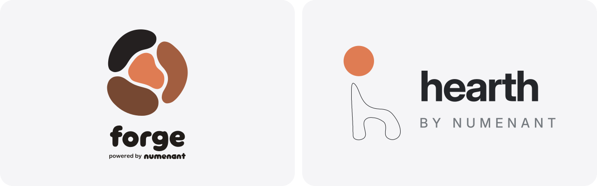
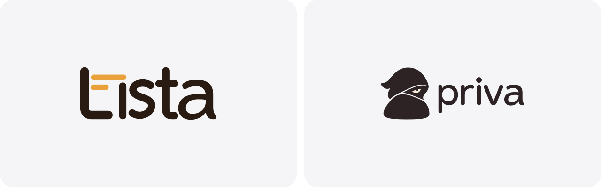

# Works Lab

Open hardware and software by Kadeem and Bryan.

Practical projects across hardware, product design, firmware, robotics, and local-first tools. These are all our ideas we refused to leave in a notes app.

## [Numenant](https://github.com/Works-Lab/numenant)

**Machine intelligence working for you.**

Numenant understands the system it lives in and acts on it. One foundation, built to run multiple domains.

**Forge**\
Fabrication.\
*In development*

**Grove**\
Cultivation.\
*In development*

**Hearth**\
Home.\
*In development*

## [Panelini](https://github.com/Works-Lab/panelini)

Small personal apps.

**Lista**\
A checklist, one click away.\
*In development*

**Priva**\
On device privacy you own.\
*In development*

## [OTO v2](https://github.com/Works-Lab/oto)

**What if your whiteboard could clean itself?**

OTO v2 builds on [OTO](https://github.com/Keem-tt/OTO-Whiteboard-Cleaner), a senior capstone project made with printed parts, Arduino control, and rack-and-pinion motion. The goal for v2: faster, cheaper, and sleeker.

*Paused*

## [Trace](https://github.com/Works-Lab/trace)

**A kitchen scale like no other**

*Paused*

## How we work

We document projects as they take shape: prototypes, design notes, firmware, CAD, and the tradeoffs between them. The goal? Having fun :)
